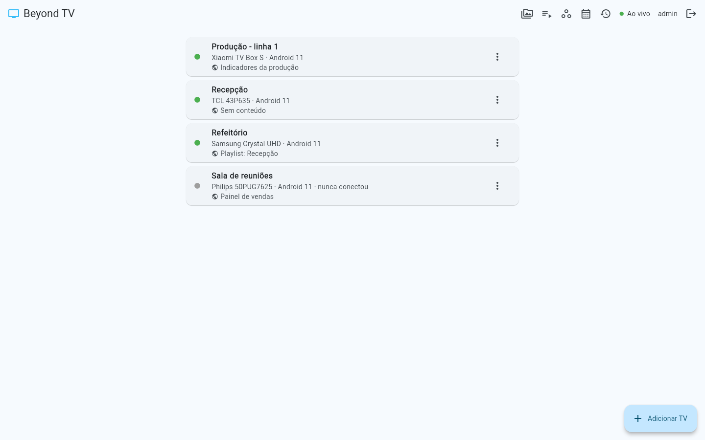
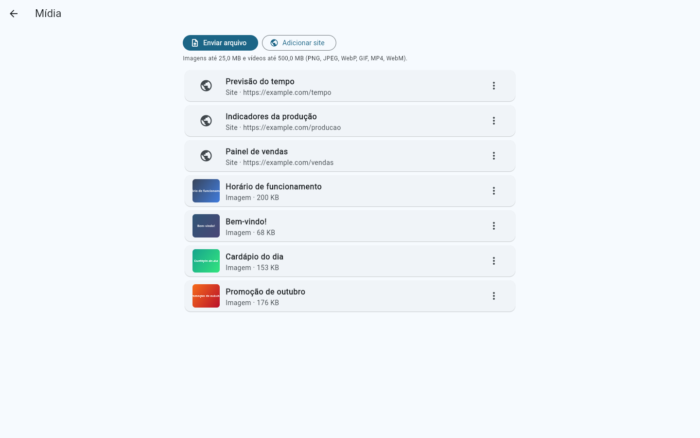
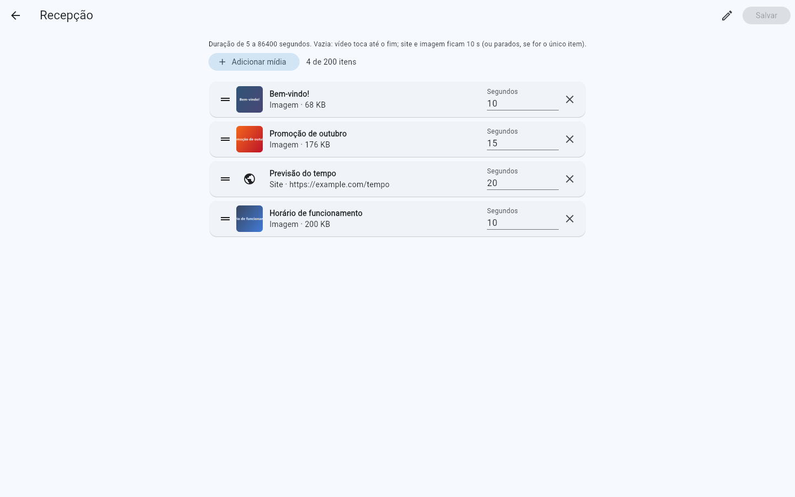
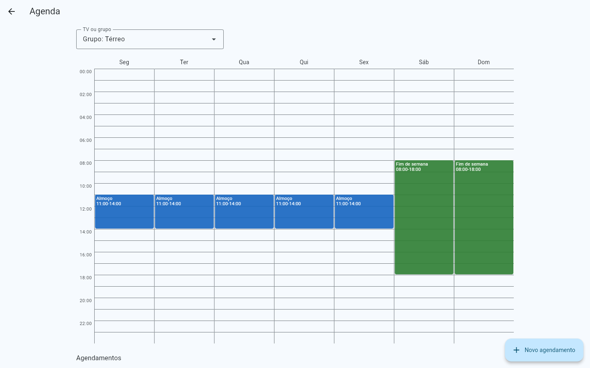

# Beyond TV

Sistema de *digital signage* **auto-hospedado** para redes locais. Com ele você
controla várias TVs Android a partir de um painel web que roda no seu próprio PC.



## Guia rápido

Você precisa de um PC com Windows e de TVs (ou TV boxes) Android 7 ou mais
novo, todos na mesma rede.

1. Baixe em [Releases](https://github.com/abiass/beyond-TV/releases/latest)
   o `beyond-tv-server-…-windows-x64.zip` e o `beyond-tv-….apk`.
2. **No PC:** descompacte o zip e dê dois cliques em
   `Iniciar Beyond TV.bat`. Quando o Windows perguntar sobre o firewall,
   permita o acesso em redes **privadas**.
3. Abra `http://localhost:8787` no navegador e crie o administrador.
4. **Na TV:** instale o APK por pen drive ou `adb`
   ([passo a passo](docs/instalacao-tv.md)) e abra o app.
5. A TV acha o servidor sozinha (se não achar, use **Digitar IP** com o IP
   do PC) e aparece no painel em **Aguardando aprovação**. Confira o código
   de 4 dígitos que está na tela da TV e clique em **Aprovar**. Também dá
   para parear digitando um código gerado em **Adicionar TV**.
6. Cadastre sites, imagens e vídeos em **Mídia**, monte playlists e escolha
   o que cada TV (ou grupo de TVs) exibe. Em **Agenda** você troca o
   conteúdo por dia e horário.

Os dados ficam na pasta `data`, ao lado do `.bat`. Para atualizar o servidor,
troque os outros arquivos e mantenha essa pasta.

| Mídia | Playlist | Agenda |
|-------|----------|--------|
|  |  |  |

## Como funciona

1. Você roda o **servidor Beyond TV** no PC e abre o **dashboard** no navegador.
2. Instala o **app Beyond TV** (APK) em cada TV Android.
3. No dashboard, clica em **Adicionar TV** e recebe um código.
4. Digita esse código na TV. Pronto, ela está pareada.
5. Agora você escolhe o que cada TV exibe: sites e dashboards, imagens, vídeos e
   playlists. Também dá para agendar conteúdos por horário.

## Componentes

| Pasta | O que é | Tecnologia |
|-------|---------|------------|
| `apps/server` | API, tempo real, descoberta na rede | Dart (shelf) + SQLite |
| `apps/dashboard` | Painel de administração | Flutter Web |
| `apps/tv` | Player para Android TV | Flutter (Android) |
| `packages/beyond_protocol` | Modelos compartilhados | Dart |

## Rodando localmente

Pré-requisitos: Flutter SDK (stable, Dart ≥ 3.6) e, para o app da TV, Android
SDK com o emulador Android TV. Detalhes na
[seção 14 do plano](docs/PLANO_DE_DESENVOLVIMENTO.md#14-ambiente-de-desenvolvimento).

```sh
flutter pub get        # na raiz: resolve todo o workspace de uma vez
```

| O quê | Comando | Resultado |
|-------|---------|-----------|
| Servidor | `dart run apps/server/bin/server.dart` | `http://localhost:8787/health` |
| Dashboard pelo servidor | `cd apps/dashboard && flutter build web`, depois rode o servidor | `http://localhost:8787/` |
| Dashboard (só a interface) | `cd apps/dashboard && flutter run -d chrome` | Abre o painel no Chrome, mas sem falar com a API |
| App da TV | `cd apps/tv && flutter run` | Instala no emulador/TV conectada |
| APK de debug | `cd apps/tv && flutter build apk --debug` | `apps/tv/build/app/outputs/flutter-apk/` |
| Análise | `flutter analyze` (na raiz) | Analisa todos os pacotes |
| Testes | `dart test` ou `flutter test` dentro de cada pacote | |

O dashboard chama a API na mesma origem em que foi aberto, e o servidor recusa
requisições de outra origem (proteção contra CSRF). Para testar login e as
telas que usam dados, compile com `flutter build web` e abra pelo servidor.

O servidor aceita `--port`, `--discovery-port`, `--data-dir`, `--web-dir` e
`--log-level` (ou as variáveis `BEYOND_PORT`, `BEYOND_DISCOVERY_PORT`,
`BEYOND_DATA_DIR`, `BEYOND_WEB_DIR` e `BEYOND_LOG_LEVEL`, veja o
[.env.example](.env.example)). Os caminhos padrão consideram que o servidor
roda a partir da raiz do repositório. Use
`dart run apps/server/bin/server.dart --help` para ver todas as opções.

### Pareando uma TV em desenvolvimento

1. Rode o servidor e abra `http://localhost:8787/` (com o dashboard
   compilado). Na primeira vez, crie o administrador.
2. Clique em **Adicionar TV** e anote o código.
3. Abra o app na TV. Ele procura o servidor na rede; escolha-o e digite o
   código. No **emulador** a descoberta não alcança o PC: use **Digitar IP**
   com `10.0.2.2` (o endereço do PC visto de dentro do emulador).

Detalhes do fluxo em [docs/protocolo.md](docs/protocolo.md). Para instalar numa
TV de verdade (adb, pen drive, abrir ao ligar e modo quiosque), veja
[docs/instalacao-tv.md](docs/instalacao-tv.md).

### Gerando a release

| O quê | Comando | Resultado |
|-------|---------|-----------|
| Servidor para Windows | `powershell -ExecutionPolicy Bypass -File tool\build-server-windows.ps1` | `dist\beyond-tv-server-<versão>-windows-x64.zip` |
| APK assinado | `cd apps/tv && flutter build apk --release` | `apps/tv/build/app/outputs/flutter-apk/app-release.apk` |

O APK de release precisa do `apps/tv/android/key.properties` (veja a seção
de assinatura em [docs/instalacao-tv.md](docs/instalacao-tv.md)). Guarde a
keystore com cuidado: sem ela, as próximas versões não instalam por cima.

### Problemas conhecidos no Windows

- **Caminho com acento ou espaço** (ex.: `Área de Trabalho`): o `dart test`
  falha com *"package_config.json did not contain its own root package"* e o
  Gradle também costuma se perder. Clone o projeto num caminho simples, como
  `C:\dev\beyond-TV`, ou crie uma unidade virtual:

  ```powershell
  subst X: "C:\caminho\com\acento"   # depois trabalhe a partir de X:\
  subst X: /D                         # remove a unidade
  ```

- **NDK ausente** (*"sdkmanager did not install NDK …"*): instale a versão
  pedida no erro pelo Android Studio (*SDK Manager → SDK Tools → NDK*) ou por
  linha de comando, com aspas por causa do `;`:

  ```powershell
  sdkmanager --sdk_root=<pasta-do-sdk> "ndk;<versão>"
  ```

- **Kotlin "Could not close incremental caches"** no `flutter build apk`:
  acontece quando o projeto e o cache do pub estão em discos diferentes
  (ex.: `C:` e `D:`). Desligue a compilação incremental do Kotlin nesse
  build:

  ```powershell
  flutter build apk --debug --android-project-arg=kotlin.incremental=false
  ```

## Privacidade

Tudo roda **na sua rede local**. O projeto não usa nuvem nem telemetria e não
envia dados a terceiros.

## Contribuindo

Veja o [CONTRIBUTING.md](CONTRIBUTING.md). Para relatar uma falha de
segurança, siga o [SECURITY.md](SECURITY.md).

## Licença

Distribuído sob a licença [MIT](LICENSE).
