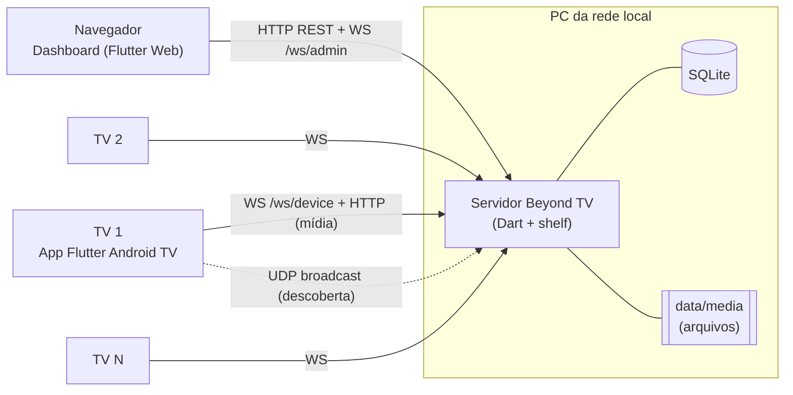
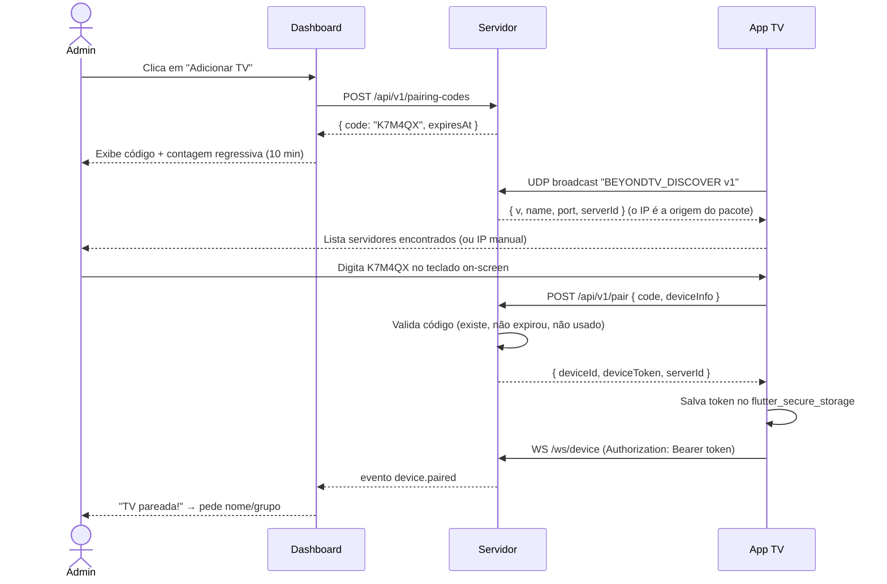
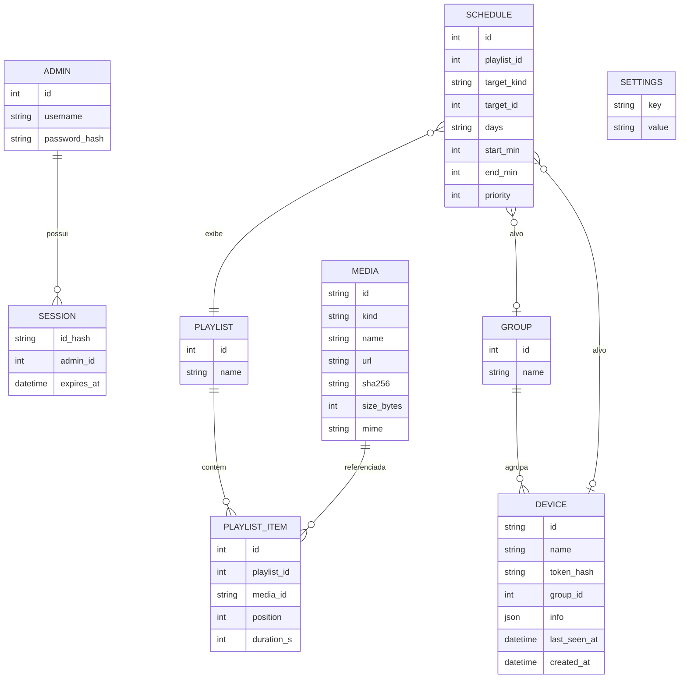

# Beyond TV — Plano de Desenvolvimento

> Documento-guia do projeto. Toda decisão de arquitetura, convenção e etapa de
> desenvolvimento parte daqui. Atualize este arquivo **no mesmo commit** em que
> uma decisão mudar.

---

## Sumário

1. [Visão do produto](#1-visão-do-produto)
2. [Escopo: MVP, v1 e futuro](#2-escopo-mvp-v1-e-futuro)
3. [Arquitetura](#3-arquitetura)
4. [Stack e decisões técnicas](#4-stack-e-decisões-técnicas)
5. [Estrutura do repositório](#5-estrutura-do-repositório)
6. [Pareamento das TVs](#6-pareamento-das-tvs)
7. [Protocolo de comunicação](#7-protocolo-de-comunicação)
8. [Modelo de dados](#8-modelo-de-dados)
9. [App da TV (Android TV)](#9-app-da-tv-android-tv)
10. [Segurança — repositório público](#10-segurança--repositório-público)
11. [Convenções de commits, branches e versões](#11-convenções-de-commits-branches-e-versões)
12. [Roadmap por fases (com commits)](#12-roadmap-por-fases-com-commits)
13. [Estratégia de testes](#13-estratégia-de-testes)
14. [Ambiente de desenvolvimento](#14-ambiente-de-desenvolvimento)
15. [Riscos e pontos de atenção](#15-riscos-e-pontos-de-atenção)

---

## 1. Visão do produto

**Beyond TV** é um sistema de *digital signage* auto-hospedado para redes locais.
Ele tem três partes:

- **Servidor local**: roda no PC da rede. Guarda o cadastro das TVs, os conteúdos
  e as playlists, e conversa com as TVs em tempo real.
- **Dashboard web**: painel de administração aberto no navegador
  (`http://<ip-do-pc>:8787`). Serve para cadastrar TVs, enviar conteúdo e
  controlá-las.
- **App Android TV (APK)**: instalado em cada TV. Na primeira execução, pede um
  **código de pareamento** gerado no dashboard. Depois disso, exibe o conteúdo
  que o servidor mandar: sites (como dashboards de BI), imagens, vídeos e
  playlists.

A referência de produto é o [TV Player](https://www.tvplayer.com.br/pt), mas
**apenas como inspiração funcional**. Nenhuma marca, asset ou código de terceiros
deve entrar no repositório.

### Casos de uso principais

| # | Como… | Quero… | Para… |
|---|-------|--------|-------|
| UC1 | administrador | gerar um código no PC e digitá-lo na TV | vincular a TV ao meu servidor |
| UC2 | administrador | definir a URL de um dashboard para uma TV | exibir indicadores em tempo real |
| UC3 | administrador | ver quais TVs estão online/offline | saber se as telas funcionam |
| UC4 | administrador | montar playlists com sites, imagens e vídeos | alternar conteúdos automaticamente |
| UC5 | administrador | agrupar TVs (ex.: "Recepção") | mudar várias telas de uma vez |
| UC6 | administrador | recarregar, identificar ou desparear uma TV remotamente | operar sem ir até a TV |
| UC7 | administrador | agendar conteúdos por horário/dia | ter grades diferentes ao longo do dia |

---

## 2. Escopo: MVP, v1 e futuro

**MVP (v0.x): o necessário para o caso principal.**
- Configuração inicial com criação da senha de administrador e login.
- Pareamento de TV por código.
- Lista de TVs com status online/offline em tempo real.
- Atribuição de **uma URL** (site/dashboard) a uma TV.
- Comandos remotos: recarregar, identificar (mostra o nome na tela) e desparear.
- Descoberta automática do servidor na rede e fallback com IP manual.

**v1.0: digital signage completo.**
- Biblioteca de mídia com upload de imagem e vídeo.
- Playlists com duração por item.
- Grupos de TVs.
- Agendamento por dia da semana e faixa de horário.
- Cache offline na TV: continua exibindo se o servidor cair.
- Captura de tela remota (preview no dashboard).
- Início automático no boot e modo quiosque.

**Futuro (pós-v1).**
- Layouts com zonas (tela dividida, letreiro/ticker, relógio e clima).
- Múltiplos usuários e perfis.
- HTTPS opcional com certificado local.
- Atualização do APK distribuída pelo próprio servidor.
- Instalador/ícone de bandeja para Windows.

---

## 3. Arquitetura



- O **servidor** é o único ponto de verdade. Ele expõe uma API REST, dois canais
  WebSocket (um para o dashboard e outro para as TVs), serve os arquivos de mídia
  e serve o build estático do dashboard. Como dashboard e API ficam na mesma
  origem, não é preciso configurar CORS.
- As **TVs** mantêm uma conexão WebSocket persistente com reconexão automática
  (backoff exponencial). Quando o conteúdo muda, o servidor envia um *manifesto*.
  A TV baixa o que falta, guarda em cache e passa a exibir.
- O **dashboard** recebe eventos ao vivo, como TV conectou, caiu ou trocou de
  item.

---

## 4. Stack e decisões técnicas

| Camada | Escolha | Por quê |
|--------|---------|---------|
| Linguagem | **Dart em tudo** | Um único idioma; os modelos do protocolo ficam num pacote compartilhado entre servidor, dashboard e TV. |
| Monorepo | **Pub workspaces** (Dart ≥ 3.6) | Nativo do Dart, sem ferramenta extra. O Melos é opcional para scripts. |
| Servidor | `shelf`, `shelf_router`, `shelf_static`, `shelf_web_socket` | Leve, roda no Windows/Linux/macOS e compila para executável (`dart compile exe`). |
| Banco | **SQLite** (`sqlite3` + migrações versionadas) | Arquivo único, zero configuração, ideal para uso local. |
| Senhas | `bcrypt` | Hash adaptativo e padrão de mercado. |
| Descoberta | **UDP broadcast** em porta dedicada | Simples em Dart puro. Responder mDNS no Windows é instável. O IP manual fica como fallback. |
| Dashboard | **Flutter Web** + `go_router` + `flutter_riverpod` | Mesma stack do app da TV e reaproveita o pacote de protocolo. |
| App TV | Flutter (Android) + `webview_flutter`, `video_player`, `wakelock_plus`, `flutter_secure_storage` | WebView do sistema para sites, ExoPlayer para vídeo e token guardado no Android Keystore. |
| Serialização | `json_serializable` | Gera o código de JSON com tipagem forte. |
| Lint | `flutter_lints` (ou `very_good_analysis`) | Mantém a qualidade consistente. |
| CI | GitHub Actions | Roda análise, testes, build do APK de debug e varredura de segredos. |

> Toda decisão relevante vira uma **ADR** em `docs/adr/NNNN-titulo.md`, com
> contexto, decisão e consequências. As ADRs 0001–0004 registram as escolhas
> acima.

### Portas padrão (configuráveis)

| Porta | Uso |
|-------|-----|
| `8787/tcp` | HTTP (dashboard, API, mídia) e WebSocket |
| `8788/udp` | Descoberta do servidor pelas TVs |

---

## 5. Estrutura do repositório

```
beyond-TV/
├── apps/
│   ├── server/              # Servidor Dart (API, WS, descoberta, serve o dashboard)
│   │   ├── bin/server.dart
│   │   ├── lib/src/{api,ws,db,auth,pairing,discovery,media}/
│   │   └── test/
│   ├── dashboard/           # Flutter Web — painel administrativo
│   └── tv/                  # Flutter Android TV — player
├── packages/
│   └── beyond_protocol/     # Modelos e mensagens compartilhados (Dart puro)
├── docs/
│   ├── PLANO_DE_DESENVOLVIMENTO.md   ← este arquivo
│   ├── adr/                 # Architecture Decision Records
│   ├── protocolo.md         # Especificação das mensagens WS/REST
│   ├── seguranca.md         # Modelo de ameaças e práticas
│   └── instalacao-tv.md     # Como instalar o APK na TV (adb/pen drive)
├── scripts/                 # Scripts de build/dev (PowerShell + bash)
├── .github/
│   ├── workflows/ci.yml
│   ├── ISSUE_TEMPLATE/
│   └── pull_request_template.md
├── .env.example             # Somente exemplos — NUNCA o .env real
├── pubspec.yaml             # Raiz do workspace
├── CHANGELOG.md
├── CONTRIBUTING.md
├── SECURITY.md
├── LICENSE
└── README.md
```

Os dados de execução ficam fora do controle de versão e são criados na primeira
execução:

```
data/
├── beyond.db        # SQLite
├── media/           # Uploads (nome = sha256)
└── logs/
```

---

## 6. Pareamento das TVs

O código é **gerado no PC** e **digitado na TV**.

### Fluxo



### Regras

| Item | Regra |
|------|-------|
| Formato do código | 6 caracteres do alfabeto `23456789ABCDEFGHJKMNPQRSTUVWXYZ`, sem caracteres ambíguos como 0/O e 1/I/L. |
| Validade | 10 minutos e uso único. |
| Armazenamento | Só em memória no servidor; não vai para o banco. |
| Tentativas | Limite de 5 tentativas por minuto por IP em `/pair`. Depois disso, a resposta é `429`. |
| Token do dispositivo | 32 bytes aleatórios (`Random.secure`) em base64url. O servidor guarda **apenas o SHA-256** do token. |
| Na TV | O token fica no `flutter_secure_storage` (Android Keystore). |
| Revogação | Ao remover a TV no dashboard, o hash é apagado e a sessão WS é derrubada. A TV volta para a tela de pareamento. |
| Troca de servidor | O `serverId` é salvo na TV. Se outro servidor responder com outro `serverId`, a TV não reutiliza o token. |

### UX na TV

- Teclado on-screen próprio em grade 6×6, navegável pelo **D-pad**, com letras
  grandes e só os caracteres do alfabeto válido.
- Mostra o nome e o IP do servidor selecionado e permite trocar.
- Mostra o erro em linguagem clara: "código expirado", "código inválido" ou
  "servidor inacessível".

---

## 7. Protocolo de comunicação

A especificação completa fica em `docs/protocolo.md`. O resumo vem abaixo.

### REST (prefixo `/api/v1`)

| Método | Rota | Auth | Descrição |
|--------|------|------|-----------|
| GET | `/setup/status` | — | Indica se a configuração inicial já foi feita. |
| POST | `/setup` | — (só na 1ª vez) | Cria o administrador. |
| POST | `/auth/login` · `/auth/logout` | — / sessão | Login e logout com cookie de sessão. |
| GET | `/auth/session` | admin | Usuário da sessão atual (`401` se não houver). |
| POST | `/pairing-codes` | admin | Gera um código. |
| GET | `/pairing-codes/:code` | admin | Situação do código (`pending`, `paired` ou `expired`). |
| POST | `/pair` | código | A TV troca o código por um token. |
| GET/PATCH/DELETE | `/devices[/:id]` | admin | Lista, renomeia ou remove uma TV. |
| POST | `/devices/:id/commands` | admin | Envia `reload`, `identify`, `screenshot` ou `unpair`. |
| CRUD | `/groups`, `/media`, `/playlists`, `/schedules` | admin | Gestão de conteúdo. |
| GET | `/media/:id/file` | admin ou device | Download da mídia. |

### WebSocket: envelope único

```json
{ "v": 1, "type": "content.sync", "id": "uuid", "ts": "2026-10-13T12:00:00Z", "payload": { } }
```

| Direção | `type` | Conteúdo |
|---------|--------|----------|
| TV → S | `hello` | Versão do app, modelo, Android, resolução e armazenamento livre. |
| TV → S | `heartbeat` (30 s) | Item atual, uptime e erros recentes. |
| S → TV | `content.sync` | Manifesto com a lista de itens (`type`, `url`/`mediaId`, `sha256`, `duration`) e as regras de agenda. |
| S → TV | `cmd.reload` · `cmd.identify` · `cmd.screenshot` · `cmd.unpair` | Comandos remotos. |
| TV → S | `ack` · `screenshot.result` · `error` | Respostas. |
| S → Dash | `device.online` · `device.offline` · `device.paired` · `device.state` | Eventos ao vivo. |

O campo `v` permite evoluir o protocolo. O servidor recusa versões
incompatíveis com uma mensagem clara: "atualize o app da TV".

---

## 8. Modelo de dados



- `SETTINGS` guarda pares chave/valor do servidor, como o `server_id`
  gerado na primeira execução e enviado às TVs no pareamento.
- `MEDIA.kind` aceita `url`, `image` ou `video`. Um site é uma mídia do tipo
  `url`.
- Resolução de conteúdo na TV: vale o **agendamento ativo de maior prioridade**.
  Sem nenhum agendamento ativo, vale a **playlist padrão** da TV ou do grupo.
- Migrações numeradas em `apps/server/lib/src/db/migrations/m0001_init.dart` e
  seguintes, com o SQL embutido no código para o executável compilado não
  depender de arquivos externos. Elas são aplicadas automaticamente na
  inicialização, cada uma numa transação, e a versão fica em
  `PRAGMA user_version`. Uma migração publicada nunca é editada.

---

## 9. App da TV (Android TV)

### Requisitos do manifesto

- `<uses-feature android:name="android.software.leanback" android:required="false"/>`
- `<uses-feature android:name="android.hardware.touchscreen" android:required="false"/>`
- Intent filter com `android.intent.category.LEANBACK_LAUNCHER`, para o app
  aparecer na home da TV.
- `android:banner="@drawable/banner"` com imagem de **320×180 px**.
- Permissões: `INTERNET`, `ACCESS_NETWORK_STATE`, `ACCESS_WIFI_STATE`,
  `CHANGE_WIFI_MULTICAST_STATE` (descoberta UDP) e `RECEIVE_BOOT_COMPLETED`.
- `android:usesCleartextTraffic` limitado por `network_security_config.xml`.
  Na LAN o servidor usa HTTP; veja os riscos na seção 15.

### Telas

1. **Splash/estado**: decide entre pareamento e player.
2. **Seleção de servidor**: lista o que a descoberta encontrou e oferece
   "Digitar IP".
3. **Pareamento**: teclado on-screen, tratamento de erros e status.
4. **Player**: tela cheia, sem UI, com rotação dos itens da playlist.
5. **Overlay de identificação**: mostra o nome da TV em fonte gigante por 10 s.
6. **Menu oculto**: aberto por sequência de teclas (ex.: ⬆⬆⬇⬇) ou
   pressionando OK longamente. Mostra informações, opção de desparear e logs.

### Player

| Tipo | Implementação | Observações |
|------|---------------|-------------|
| `url` | `webview_flutter` | JS ligado, cookies persistentes (para manter a sessão de dashboards), recarga periódica opcional, sem acesso a `file://` e sem JS bridges. |
| `image` | `Image.file` (cache local) | Transição *fade*. |
| `video` | `video_player` (ExoPlayer) | Avança para o próximo item ao terminar; mudo por padrão (configurável). |

- **Cache**: os arquivos ficam em `getApplicationSupportDirectory()/media/<sha256>`.
  O app só baixa o que mudou e apaga o que ninguém mais referencia.
- **Offline**: se o servidor cair, a TV continua exibindo o último manifesto
  válido, salvo em disco.
- **Wakelock**: a tela não apaga.
- **Boot**: um `BroadcastReceiver` nativo em Kotlin abre o app depois do
  `BOOT_COMPLETED`. No Android 10+, abrir uma activity em segundo plano é
  restrito. As alternativas, que devem ser documentadas, são definir o app como
  *launcher* padrão (categoria `HOME`, modo quiosque) ou conceder a permissão
  "sobrepor a outros apps".

### Navegação por D-pad

- Usar `FocusTraversalGroup`, `Shortcuts` e `Actions` e mostrar um foco visual
  bem destacado (borda/escala).
- Testar sempre com o emulador Android TV e o controle remoto, nunca só com o
  mouse.

---

## 10. Segurança — repositório público

> **Regra de ouro:** nada que identifique sua rede, suas credenciais ou seus
> dados entra no git. O repositório tem que poder ser clonado por qualquer
> pessoa sem expor nada seu.

### O que **nunca** é commitado (o `.gitignore` já cobre)

- `data/` (banco, uploads, logs), `*.db`, `*.sqlite`.
- `.env` e variantes. Só o `.env.example`, com valores fictícios, vai para o git.
- Chaves de assinatura Android: `*.jks`, `*.keystore`, `key.properties`.
- `local.properties`, `google-services.json` e certificados (`*.pem`, `*.key`,
  `*.p12`).
- Builds: `build/`, `.dart_tool/`, `*.apk`, `*.aab`. O APK é distribuído pelo
  GitHub Releases, nunca pelo código.
- IPs reais, nomes de host da sua rede e URLs internas de dashboards. Use
  `192.168.0.10` / `example.local` nos exemplos.
- Screenshots que mostrem dados reais de dashboards.

### Práticas obrigatórias

1. **E-mail dos commits**: use o e-mail *noreply* do GitHub
   (`ID+usuario@users.noreply.github.com`) e ative em
   *Settings → Emails → Keep my email addresses private*.
2. **GitHub**: ative *Secret scanning*, *Push protection*, *Dependabot alerts*
   e proteção da branch `main`.
3. **CI**: o job `gitleaks` roda em todo push/PR e o build falha se achar algo.
4. **Antes de cada commit**: rodar `git diff --staged` e revisar.
5. **Assinatura do APK de release**: o keystore fica **fora do repositório**. O
   `key.properties` aponta para ele e está no `.gitignore`. Se um dia houver
   release pelo CI, use *GitHub Secrets* com o keystore em base64.

### Segurança da aplicação

| Ameaça | Mitigação |
|--------|-----------|
| Acesso ao dashboard por qualquer pessoa da LAN | Login obrigatório e senha criada no primeiro uso, **sem senha padrão**. |
| Força bruta no login e no pareamento | Rate limit por IP e atraso progressivo. |
| Roubo de sessão | Cookie `HttpOnly` + `SameSite=Strict`, ID de sessão aleatório guardado em hash, expiração. |
| CSRF | Mesma origem, `SameSite=Strict` e checagem de `Origin` nos métodos mutáveis. |
| Upload malicioso | Lista de MIME permitidos, limite de tamanho, nome do arquivo = sha256 (sem nome do usuário no path) e checagem contra *path traversal*. |
| URL maliciosa no WebView | Só `http`/`https`, sem `file://` nem `javascript:`. |
| Tráfego em texto puro na LAN | Aceito no MVP e documentado em `docs/seguranca.md`. HTTPS opcional no roadmap. |
| Token de TV vazado | O token só existe em hash no servidor e pode ser revogado individualmente. |

---

## 11. Convenções de commits, branches e versões

### Commits: [Conventional Commits](https://www.conventionalcommits.org/pt-br/)

```
<tipo>(<escopo>): <descrição curta no imperativo, em português>

<corpo opcional: o quê e por quê>
```

- **Tipos**: `feat`, `fix`, `docs`, `chore`, `refactor`, `test`, `ci`, `build`,
  `perf`, `style`.
- **Escopos**: `server`, `dashboard`, `tv`, `protocol`, `repo`, `docs`, `ci`.
- Exemplo: `feat(server): gera códigos de pareamento com expiração de 10 min`.
- **Um commit faz uma coisa.** Código e teste da mesma funcionalidade vão juntos.
  Documentação que muda por causa do código vai no mesmo commit.

### Branches e fases

- `main` está sempre estável e protegida.
- Cada fase é desenvolvida em `fase/NN-nome` (ex.: `fase/04-pareamento`) e entra
  na `main` por **Pull Request**. A descrição do PR resume o que foi feito e como
  testar.
- No fim de cada fase:
  - atualizar o `CHANGELOG.md`;
  - marcar a fase como concluída na seção 12;
  - criar a tag `v0.NN.0`.

### Versões

- SemVer. Do MVP até antes do v1 usamos `0.x`. O v1 completo vira `1.0.0`.
- A versão do app da TV (`pubspec.yaml`, `version: x.y.z+build`) sobe junto com
  a tag.

---

## 12. Roadmap por fases (com commits)

Legenda: ⬜ a fazer · 🟨 em andamento · ✅ concluído

### Fase 0 — Fundação do repositório ✅
| # | Commit | Status |
|---|--------|--------|
| 0.1 | `chore(repo): adiciona .gitignore com proteções para repositório público` | ✅ |
| 0.2 | `docs: adiciona plano de desenvolvimento do Beyond TV` | ✅ |
| 0.3 | `docs: adiciona README inicial` | ✅ |
| 0.4 | `docs: adiciona licença MIT` | ✅ |
| 0.5 | `docs: adiciona SECURITY.md e CONTRIBUTING.md` | ✅ |
| 0.6 | `docs(adr): registra ADRs 0001–0004 (Dart full-stack, workspace, SQLite, descoberta UDP)` | ✅ |
| 0.7 | `chore(repo): adiciona .editorconfig, templates de issue e PR` | ✅ |

**Pronto quando:** o repositório público estiver com documentação, regras de
segurança e GitHub configurado (secret scanning, proteção de branch).

### Fase 1 — Esqueleto do monorepo ✅
| # | Commit | Status |
|---|--------|--------|
| 1.1 | `build: cria workspace Dart na raiz` | ✅ |
| 1.2 | `feat(protocol): cria pacote beyond_protocol com envelope de mensagens` | ✅ |
| 1.3 | `feat(server): cria servidor shelf com rota /health` | ✅ |
| 1.4 | `feat(dashboard): cria app Flutter Web vazio` | ✅ |
| 1.5 | `feat(tv): cria app Flutter Android TV com manifesto leanback e banner` | ✅ |
| 1.6 | `ci: adiciona workflow com analyze, test e gitleaks` | ✅ |
| 1.7 | `docs: documenta como rodar cada app localmente` | ✅ |

**Pronto quando:** `dart run apps/server/bin/server.dart` responder `/health`, o
dashboard abrir no Chrome, o APK de debug instalar no emulador TV e o CI estiver
verde.

### Fase 2 — Núcleo do servidor ✅
| # | Commit | Status |
|---|--------|--------|
| 2.1 | `feat(server): adiciona configuração por args/env (porta, pasta de dados)` | ✅ |
| 2.2 | `feat(server): adiciona SQLite com sistema de migrações` | ✅ |
| 2.3 | `feat(server): adiciona migração inicial (admin, sessões, devices, grupos)` | ✅ |
| 2.4 | `feat(server): adiciona logging estruturado e tratamento de erros` | ✅ |
| 2.5 | `feat(server): serve build estático do dashboard` | ✅ |

### Fase 3 — Autenticação do administrador ✅
| # | Commit | Status |
|---|--------|--------|
| 3.1 | `feat(server): adiciona setup inicial e criação de admin com bcrypt` | ✅ |
| 3.2 | `feat(server): adiciona login/logout com sessão em cookie seguro` | ✅ |
| 3.3 | `feat(server): adiciona rate limit e checagem de Origin` | ✅ |
| 3.4 | `feat(dashboard): adiciona telas de setup inicial e login` | ✅ |
| 3.5 | `test(server): cobre fluxos de setup, login e sessão expirada` | ✅ |

### Fase 4 — Pareamento ✅
| # | Commit | Status |
|---|--------|--------|
| 4.1 | `feat(protocol): adiciona modelos de pareamento e DeviceInfo` | ✅ |
| 4.2 | `feat(server): gera códigos de pareamento com expiração e uso único` | ✅ |
| 4.3 | `feat(server): adiciona endpoint /pair com emissão de token` | ✅ |
| 4.4 | `feat(server): responde descoberta via UDP broadcast` | ✅ |
| 4.5 | `feat(tv): adiciona descoberta de servidor e entrada de IP manual` | ✅ |
| 4.6 | `feat(tv): adiciona tela de pareamento com teclado para D-pad` | ✅ |
| 4.7 | `feat(tv): armazena token no secure storage` | ✅ |
| 4.8 | `feat(dashboard): adiciona fluxo "Adicionar TV" com código e contador` | ✅ |
| 4.9 | `test(server): cobre código expirado, reutilizado e rate limit` | ✅ |
| 4.10 | `docs: documenta fluxo de pareamento em protocolo.md` | ✅ |

**Marco:** a TV aparece no dashboard depois de digitar o código. 🎉

### Fase 5 — Tempo real ✅
| # | Commit | Status |
|---|--------|--------|
| 5.1 | `feat(server): adiciona WS /ws/device autenticado por token` | ✅ |
| 5.2 | `feat(server): adiciona WS /ws/admin com eventos de status` | ✅ |
| 5.3 | `feat(tv): conecta WS com reconexão e backoff exponencial` | ✅ |
| 5.4 | `feat(tv): envia hello e heartbeat` | ✅ |
| 5.5 | `feat(dashboard): lista TVs com status online/offline ao vivo` | ✅ |
| 5.6 | `feat(dashboard): permite renomear e remover TV (revoga token)` | ✅ |

### Fase 6 — Exibir sites (MVP) ✅
| # | Commit | Status |
|---|--------|--------|
| 6.1 | `feat(server): adiciona mídia do tipo url e atribuição a device` | ✅ |
| 6.2 | `feat(server): envia content.sync ao alterar conteúdo` | ✅ |
| 6.3 | `feat(tv): adiciona player WebView em tela cheia com wakelock` | ✅ |
| 6.4 | `feat(tv): persiste último manifesto para modo offline` | ✅ |
| 6.5 | `feat(server,tv): adiciona comandos reload, identify e unpair` | ✅ |
| 6.6 | `feat(dashboard): adiciona tela de detalhes da TV com URL e comandos` | ✅ |

**Marco → tag `v0.6.0` = MVP utilizável.**

### Fase 7 — Biblioteca de mídia e playlists ✅
| # | Commit | Status |
|---|--------|--------|
| 7.1 | `feat(server): adiciona upload de imagem/vídeo com validação de MIME e tamanho` | ✅ |
| 7.2 | `feat(server): adiciona CRUD de playlists e itens` | ✅ |
| 7.3 | `feat(tv): adiciona cache de mídia por sha256` | ✅ |
| 7.4 | `feat(tv): adiciona players de imagem e vídeo com transição` | ✅ |
| 7.5 | `feat(tv): adiciona rotação de playlist por duração` | ✅ |
| 7.6 | `feat(dashboard): adiciona biblioteca de mídia com upload` | ✅ |
| 7.7 | `feat(dashboard): adiciona editor de playlist com reordenação` | ✅ |

### Fase 8 — Grupos e agendamento ✅
| # | Commit | Status |
|---|--------|--------|
| 8.1 | `feat(server): adiciona grupos e atribuição em lote` | ✅ |
| 8.2 | `feat(server): adiciona agendamentos com prioridade` | ✅ |
| 8.3 | `feat(tv): resolve agenda localmente (funciona offline)` | ✅ |
| 8.4 | `feat(dashboard): adiciona telas de grupos e agenda semanal` | ✅ |
| 8.5 | `test: cobre resolução de agenda (sobreposição, virada de dia)` | ✅ |

### Fase 9 — Operação remota ✅
| # | Commit | Status |
|---|--------|--------|
| 9.1 | `feat(tv): adiciona captura de tela sob demanda` | ✅ |
| 9.2 | `feat(dashboard): exibe preview da tela de cada TV` | ✅ |
| 9.3 | `feat(tv): adiciona menu oculto com informações e desparear` | ✅ |
| 9.4 | `feat(server): registra log de auditoria de ações do admin` | ✅ |

### Fase 10 — Robustez Android TV ✅
| # | Commit | Status |
|---|--------|--------|
| 10.1 | `feat(tv): inicia automaticamente após boot` | ✅ |
| 10.2 | `feat(tv): adiciona modo quiosque opcional (launcher)` | ✅ |
| 10.3 | `build(tv): configura assinatura de release via key.properties (fora do git)` | ✅ |
| 10.4 | `docs: adiciona guia de instalação na TV (adb e pen drive)` | ✅ |
| 10.5 | `perf(tv): otimiza memória do WebView e vídeos em TVs de baixo custo` | ✅ |

### Fase 11 — Release 1.0 ⬜
| # | Commit |
|---|--------|
| 11.1 | `build(server): adiciona script de build do executável Windows` |
| 11.2 | `docs: revisa README com prints e guia rápido` |
| 11.3 | `chore: prepara release 1.0.0` |

**Marco → tag `v1.0.0`, APK assinado e executável do servidor publicados no
GitHub Releases.**

---

## 13. Estratégia de testes

| Camada | Tipo | Ferramenta | Foco |
|--------|------|------------|------|
| `beyond_protocol` | Unitário | `package:test` | (De)serialização e compatibilidade de versões. |
| Servidor | Unitário e integração | `package:test` + servidor em memória/porta efêmera | Auth, pareamento, rate limit, migrações, resolução de agenda. |
| Dashboard | Widget | `flutter_test` | Formulários, estados de carregando/erro. |
| TV | Widget e manual | `flutter_test` + emulador Android TV | Teclado D-pad, transições do player, reconexão. |
| Ponta a ponta | Manual guiado | Checklist no PR | Parear, trocar URL, derrubar o servidor, voltar. |

Meta inicial: **testes obrigatórios no servidor e no protocolo**, onde moram a
segurança e as regras. Na UI, o foco é o que tem lógica.

---

## 14. Ambiente de desenvolvimento

### Pré-requisitos

- **Flutter SDK (stable)** com Dart ≥ 3.6.
- Android Studio com Android SDK, **NDK** (versão pedida pelo Flutter),
  **imagem de emulador Android TV** e `adb`.
- Projeto num caminho **sem acentos**: o `dart test` em workspaces e o Gradle
  falham com caminhos como `Área de Trabalho`. Veja o README.
- Git e, opcionalmente, GitHub CLI (`gh`).
- Chrome, para depurar o dashboard.

### Instalar o APK numa TV real

1. Na TV: *Configurações → Sobre → Build* (clicar 7×) para ativar o modo
   desenvolvedor e depois ligar a **Depuração USB/ADB pela rede**.
2. No PC: `adb connect <ip-da-tv>:5555`, depois
   `adb install -r app-release.apk`.
3. Alternativa sem `adb`: copiar o APK para um pen drive e instalar com um
   gerenciador de arquivos na TV.

### Rede/Firewall (Windows)

Libere no Firewall do Windows a porta **8787/TCP** e a **8788/UDP** para redes
*privadas*. O PC e as TVs precisam estar na mesma sub-rede, porque o broadcast
UDP não atravessa roteadores.

---

## 15. Riscos e pontos de atenção

| Risco | Impacto | Mitigação |
|-------|---------|-----------|
| WebView desatualizado em TVs antigas | Sites modernos podem quebrar. | Documentar a atualização do *Android System WebView*; versão mínima do Android = 7 (API 24). |
| Dashboards que exigem login (Power BI, Grafana…) | A TV não tem teclado para logar. | Preferir links públicos/embed ou com token. Os cookies persistentes ajudam. |
| Abertura automática no boot bloqueada | A TV liga sem exibir nada. | Modo launcher (quiosque) documentado. |
| Broadcast UDP bloqueado (rede corporativa, isolamento de clientes no Wi-Fi) | A descoberta falha. | O IP manual está sempre disponível. |
| Tráfego HTTP sem TLS na LAN | Alguém na rede pode ler o tráfego. | Aceito no MVP e documentado; HTTPS no roadmap. |
| Vídeos pesados em TVs fracas | Travamentos. | Recomendar H.264 1080p e mostrar no dashboard o tamanho/codec. |
| IP do PC muda (DHCP) | As TVs perdem o servidor. | A TV refaz a descoberta automaticamente ao perder a conexão. Recomendar IP fixo/reserva DHCP. |
| Vazamento acidental de dados no repositório | Exposição pública. | `.gitignore`, gitleaks no CI, push protection e revisão do diff. |
