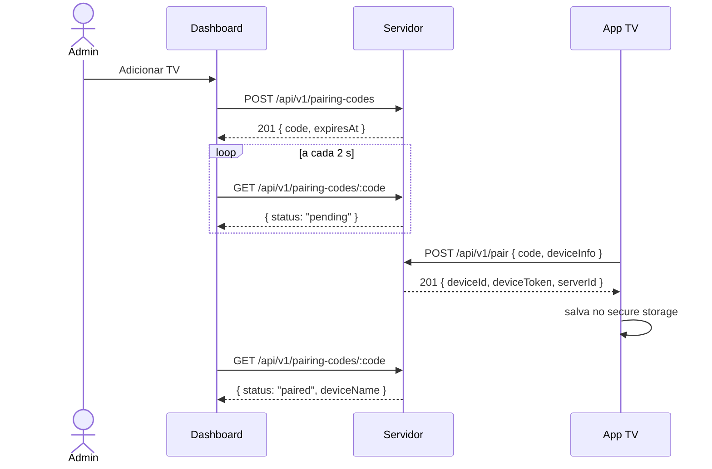
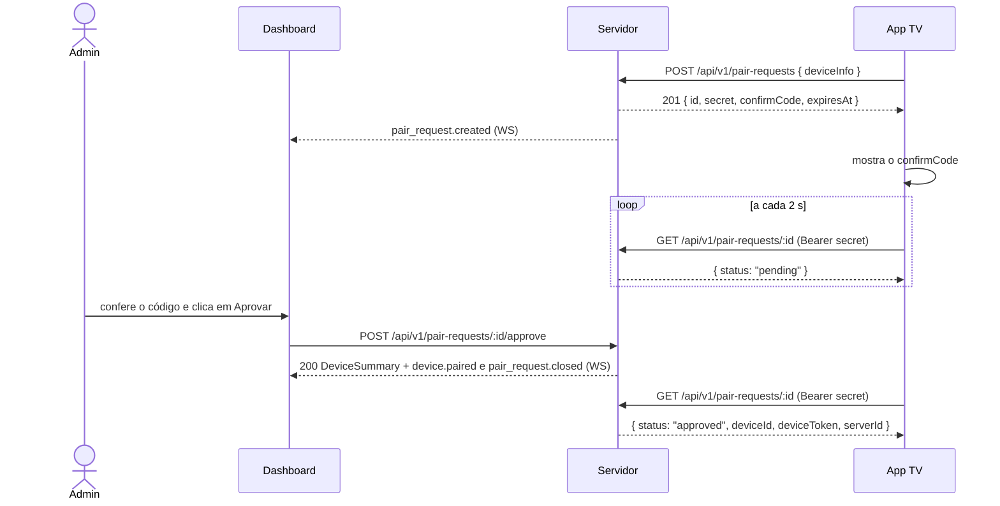
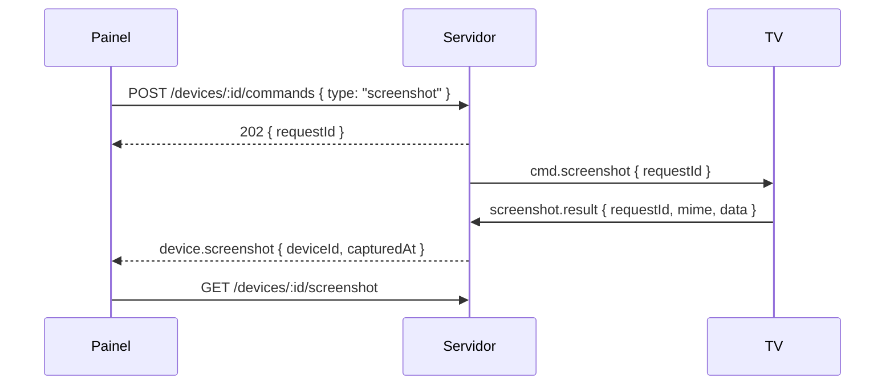

# Protocolo do Beyond TV

Especificação das mensagens entre o servidor, o dashboard e as TVs. O resumo
fica na [seção 7 do plano](PLANO_DE_DESENVOLVIMENTO.md#7-protocolo-de-comunicação);
este documento traz os detalhes do que já está implementado. Os modelos em
Dart ficam no pacote [`beyond_protocol`](../packages/beyond_protocol).

Os exemplos usam `192.168.0.10` como IP do PC do servidor.

## Convenções

- API REST com prefixo `/api/v1`, corpo e respostas em JSON (UTF-8).
- Datas em ISO 8601 UTC (`2026-10-14T12:10:00.000Z`).
- Corpo de requisição limitado a 64 KiB (`413` acima disso).
- Erros sempre no formato abaixo. O `code` é estável e serve para o cliente
  decidir o que fazer; a `message` está em português e pode ser exibida.

  ```json
  { "error": { "code": "invalid_code", "message": "Código inválido. ..." } }
  ```

| Status | `code` | Quando |
|--------|--------|--------|
| 400 | `bad_request` | JSON inválido ou campo ausente. |
| 401 | `unauthorized` | Rota de admin sem sessão válida. |
| 403 | `forbidden_origin` | Método que altera dados vindo de outra origem (CSRF). |
| 404 | `not_found` | Rota ou recurso inexistente. |
| 413 | `payload_too_large` | Corpo acima de 64 KiB. |
| 429 | `too_many_requests` | Rate limit; o cabeçalho `Retry-After` diz quantos segundos esperar. |
| 500 | `internal_error` | Erro inesperado (detalhes só no log do servidor). |

## Autenticação do administrador

O dashboard usa um cookie de sessão:

```
Set-Cookie: beyond_session=<token>; Path=/; HttpOnly; SameSite=Strict; Max-Age=604800
```

- O token tem 32 bytes aleatórios; o banco guarda só o SHA-256.
- A sessão vale 7 dias a partir do login.
- `POST`, `PUT`, `PATCH` e `DELETE` com cabeçalho `Origin` diferente do
  servidor recebem `403`. Clientes sem `Origin` (o app da TV) passam.

| Método | Rota | Auth | Corpo | Resposta |
|--------|------|------|-------|----------|
| GET | `/setup/status` | — | — | `200 { "configured": false }` |
| POST | `/setup` | — | `{ "username", "password" }` | `201 { "username" }` + cookie. `409 already_configured` se já houver admin. |
| POST | `/auth/login` | — | `{ "username", "password" }` | `200 { "username" }` + cookie. `401 invalid_login`. |
| POST | `/auth/logout` | cookie | — | `204` e apaga o cookie. |
| GET | `/auth/session` | cookie | — | `200 { "username" }` ou `401`. |

Regras:

- Usuário com 3 a 32 caracteres (`A-Z a-z 0-9 . _ -`); senha com 8
  caracteres a 72 bytes (`400 invalid_credentials`).
- Cada IP pode errar o login 5 vezes por minuto (`429`). Um login certo zera
  o contador.

## Descoberta (UDP)

A TV procura servidores na rede local por broadcast UDP
([ADR 0004](adr/0004-descoberta-udp.md)).

1. A TV envia o texto `BEYONDTV_DISCOVER v1` para `255.255.255.255:8788` e
   para o broadcast de cada rede dela (ex.: `192.168.0.255:8788`), duas
   vezes, e espera 3 segundos.
2. O servidor responde em unicast para a origem do pacote:

   ```json
   { "v": 1, "name": "PC-SALA", "port": 8787, "serverId": "3f2a…" }
   ```

3. O IP do servidor é o **endereço de origem** da resposta, não vai no JSON.
   A TV ignora respostas com outra versão (`v`) e repetidas (`serverId`).

Pacotes diferentes de `BEYONDTV_DISCOVER v1` são ignorados. A porta muda com
`--discovery-port` / `BEYOND_DISCOVERY_PORT`. Se a descoberta falhar (rede
com isolamento de clientes, broadcast bloqueado, emulador), a TV oferece
**Digitar IP**: ela confere o endereço em `GET /health` antes de seguir.

## Pareamento



### Código de pareamento

- 6 caracteres do alfabeto `23456789ABCDEFGHJKMNPQRSTUVWXYZ` (sem 0/O e
  1/I/L), gerados com `Random.secure`.
- Vale 10 minutos e uma única vez. Fica só na memória do servidor; reiniciar
  o servidor invalida os códigos pendentes.
- Depois de vencer, continua consultável por mais 10 minutos (para o
  dashboard mostrar "expirado" ou "pareado") e então é esquecido.
- A TV pode mandar o código em minúsculas ou com hífen/espaços; o servidor
  normaliza.

### Rotas

| Método | Rota | Auth | Resposta |
|--------|------|------|----------|
| POST | `/pairing-codes` | admin | `201 { "code": "K7M4QX", "expiresAt": "…" }` |
| GET | `/pairing-codes/:code` | admin | `200 { "code", "expiresAt", "status", "deviceId"?, "deviceName"? }` ou `404` |
| POST | `/pair` | — | `201 { "deviceId", "deviceToken", "serverId" }` |

`status` é `pending`, `paired` ou `expired`. `deviceId` e `deviceName`
aparecem depois do pareamento.

### `POST /api/v1/pair`

```json
{
  "code": "K7M4QX",
  "deviceInfo": {
    "appVersion": "0.1.0",
    "manufacturer": "Acme",
    "model": "TV 4K",
    "androidVersion": "11",
    "screenWidth": 1920,
    "screenHeight": 1080
  }
}
```

Só `appVersion` é obrigatório em `deviceInfo`. A TV entra com o nome
sugerido a partir de fabricante e modelo (`Acme TV 4K`), ou `Nova TV`.

| Status | `code` | Mensagem na TV |
|--------|--------|----------------|
| 201 | — | Pareada. |
| 400 | `invalid_code` | Código inválido (não existe, já foi usado ou formato errado). |
| 400 | `expired_code` | Código expirado. Gere um novo no painel. |
| 400 | `bad_request` | Pedido malformado (ex.: sem `deviceInfo`). |
| 429 | `too_many_requests` | Mais de 5 tentativas por minuto deste IP. |
| — | — | Servidor inacessível (sem resposta em 8 s). |

### Credenciais da TV

- `deviceToken`: 32 bytes aleatórios em base64url. Aparece **só** nesta
  resposta; o servidor guarda apenas o SHA-256 e não consegue recuperá-lo.
- A TV salva `deviceId`, `deviceToken` e o servidor (`host`, `port`, `name`,
  `serverId`) no `flutter_secure_storage` (Android Keystore).
- O `serverId` identifica o servidor: a TV não usa o token com um servidor
  de `serverId` diferente.
- A TV usa o token na conexão em tempo real (`WS /ws/device`, abaixo).

### Aprovação no painel (1.1)

Desde a 1.1, a TV não precisa digitar nada: ela pede para entrar e o
administrador aprova no painel. O código digitado continua valendo.



| Método | Rota | Auth | Resposta |
|--------|------|------|----------|
| POST | `/pair-requests` | — | `201 PairRequestTicket`. Corpo `{ "deviceInfo" }`. `429 too_many_requests` acima de 5 por minuto por IP; `429 too_many_pair_requests` com 20 pedidos abertos. |
| GET | `/pair-requests/:id` | TV (`Bearer <secret>`) | `200 { "status" }`: `pending`, `rejected`, `expired` ou `approved` (com as credenciais, como em `POST /pair`). |
| DELETE | `/pair-requests/:id` | TV (`Bearer <secret>`) | `204`. A TV desistiu (saiu da tela). |
| GET | `/pair-requests` | admin | `200 { "requests": [PendingPairRequest…] }`, do mais antigo para o mais novo. |
| POST | `/pair-requests/:id/approve` | admin | `200 DeviceSummary`. Cadastra a TV com o nome sugerido. |
| POST | `/pair-requests/:id/reject` | admin | `204`. |

```json
// PairRequestTicket (só a TV recebe o secret)
{ "id": "…", "secret": "…", "confirmCode": "4821", "expiresAt": "…" }
// PendingPairRequest (painel)
{ "id": "…", "confirmCode": "4821", "deviceInfo": { … }, "ip": "192.168.0.42",
  "createdAt": "…", "expiresAt": "…" }
```

Regras:

- O pedido vale 10 minutos (`pairRequestTtl`) e fica só na memória do
  servidor, como os códigos. Aprovar, recusar ou consultar um pedido vencido,
  já decidido ou esquecido responde `404`; a TV então abre outro pedido.
- `confirmCode` tem 4 dígitos e não se repete entre os pedidos abertos. Ele
  não é segredo: serve para o administrador conferir que aprova a TV certa.
- O `secret` (32 bytes, base64url) só aparece no `201`; o servidor guarda o
  SHA-256. Segredo errado ou ausente responde `404`, como pedido inexistente.
- As credenciais saem **uma única vez**: a consulta que recebe `approved`
  apaga o pedido.
- Cada IP tem no máximo um pedido aberto: um pedido novo substitui o
  anterior (que gera `pair_request.closed`).
- Eventos no `WS /ws/admin`: `pair_request.created` (`PendingPairRequest`) e
  `pair_request.closed` (`{ "id" }`, ao aprovar, recusar, substituir ou a TV
  desistir). O vencimento não gera evento; o painel tira o pedido pelo
  `expiresAt`.
- Um servidor 1.0 responde `404` ao `POST /pair-requests`; a TV então vai
  direto para o código digitado.

## TVs

| Método | Rota | Auth | Corpo | Resposta |
|--------|------|------|-------|----------|
| GET | `/devices` | admin | — | `200 { "devices": [DeviceSummary…] }`, da mais nova para a mais antiga. |
| PATCH | `/devices/:id` | admin | `{ "name" }` | `200 DeviceSummary`. `400 bad_request` se o nome tiver menos de 1 ou mais de 64 caracteres depois do trim. `404` se a TV não existe. |
| DELETE | `/devices/:id` | admin | — | `204`. Apaga a TV (e o hash do token) e derruba o WebSocket dela com `4401`. `404` se não existe. |

`DeviceSummary` (modelo em `realtime.dart`):

```json
{
  "id": "3f2a…",
  "name": "Recepção",
  "online": true,
  "createdAt": "2026-10-14T12:00:00.000Z",
  "info": { "appVersion": "0.5.0", "manufacturer": "Acme", "model": "TV 4K" },
  "groupId": null,
  "lastSeenAt": "2026-10-14T12:05:00.000Z",
  "currentItem": "https://example.local/painel",
  "content": { "mediaId": "9c1e…", "kind": "url", "name": "Painel de vendas", "url": "https://example.local/painel" }
}
```

`content` é o que o painel mandou a TV exibir (`null` se nada foi
definido). `online` vem da memória do servidor (há um WebSocket aberto), não do banco.
`currentItem` também fica só em memória e some quando a TV desconecta.

## Tempo real (WebSocket)

Todas as mensagens usam o envelope da [seção 7 do plano](PLANO_DE_DESENVOLVIMENTO.md#7-protocolo-de-comunicação)
(`{ v, type, id, ts, payload }`), em frames de texto. Os tipos ficam em
`MessageTypes` e os códigos de fechamento em `WsCloseCodes`.

| Código | Quando | O que o cliente faz |
|--------|--------|---------------------|
| `4400` | Sem `hello` em 10 s, ou mensagem que não é envelope válido. | Reconecta com backoff. |
| `4401` | Token/sessão inválidos ou TV removida no painel. | TV: apaga as credenciais e volta ao pareamento. Dashboard: volta ao login. |
| `4409` | Outra conexão da mesma TV substituiu esta. | Não reconecta. |
| `4426` | Versão de protocolo (`v`) diferente. | TV mostra "Atualize o app da TV" e tenta de novo a cada 5 min. |

### `WS /ws/device` (TV)

1. A TV conecta em `ws://<host>:<port>/ws/device` com o cabeçalho
   `Authorization: Bearer <deviceToken>`. O token nunca vai na URL.
2. Token inválido: o servidor aceita o upgrade e fecha na hora com `4401`.
   Assim a TV consegue distinguir "fui removida" de "servidor fora do ar".
3. A primeira mensagem da TV, em até 10 s, é `hello` com `HelloPayload`:

   ```json
   { "v": 1, "type": "hello", "id": "…", "ts": "…",
     "payload": { "deviceInfo": { "appVersion": "0.5.0", "model": "TV 4K" }, "currentItem": null } }
   ```

   O servidor grava `deviceInfo` em `devices.info`, atualiza
   `last_seen_at`, marca a TV online e avisa os dashboards
   (`device.online` e depois `device.state`).
4. A cada 30 s a TV manda `heartbeat` com `HeartbeatPayload`
   (`{ "uptimeSeconds": 120, "currentItem": … }`). Cada mensagem atualiza
   `last_seen_at` (no banco, no máximo uma escrita por minuto por TV).
5. Sem nenhuma mensagem por 90 s, o servidor fecha a conexão e marca a TV
   offline. Ao fechar por qualquer motivo, os dashboards recebem
   `device.offline`.
6. Uma segunda conexão da mesma TV fecha a anterior com `4409`.

A TV reconecta com backoff exponencial: 1 s, 2 s, 4 s… até 60 s, com
variação aleatória de ±20%. Uma conexão que durou mais de 60 s zera o
backoff. Depois de 3 falhas seguidas, a TV refaz a descoberta UDP e, se
achar um servidor com o mesmo `serverId` em outro IP, atualiza o endereço
salvo (o PC pode ter trocado de IP pelo DHCP).

### `WS /ws/admin` (dashboard)

1. O navegador conecta em `ws://<host>/ws/admin`; o cookie de sessão vai
   junto. O cabeçalho `Origin` precisa ser o próprio servidor, senão o
   upgrade é recusado com `403` (proteção contra *cross-site WebSocket
   hijacking*). Sessão inválida: upgrade aceito e fechamento com `4401`.
2. O dashboard não envia nada; só recebe eventos. Ao (re)conectar, ele
   recarrega `GET /devices` para não perder eventos.

| `type` | `payload` |
|--------|-----------|
| `device.paired` | `DeviceSummary` da TV recém-pareada. |
| `device.online` | `{ "deviceId" }` |
| `device.offline` | `{ "deviceId", "lastSeenAt" }` |
| `device.state` | `DeviceSummary` atualizado (hello, heartbeat com outro `currentItem`, renomeação). |
| `device.removed` | `{ "deviceId" }` |
| `pair_request.created` | `PendingPairRequest` (veja *Aprovação no painel*). |
| `pair_request.closed` | `{ "id" }` |
| `device.input_error` | `{ "deviceId", "code", "message" }` (veja *Controle ao vivo*). |

O servidor manda ping a cada 30 s nos dois canais para detectar conexões
mortas.

## Conteúdo (fase 6)

Na fase 6 cada TV exibe **um site**. Um site é uma mídia do tipo `url`
(tabela `media`, seção 8 do plano). Playlists, imagens e vídeos chegam na
fase 7.

### URLs aceitas

Só `http` e `https`, com host, sem espaços e até 2048 caracteres
(`isSafeContentUrl`). `file:`, `javascript:`, `data:` e afins são recusados
com `400 invalid_url`, tanto no servidor quanto no painel e na TV.

### Rotas

| Método | Rota | Auth | Corpo | Resposta |
|--------|------|------|-------|----------|
| GET | `/media` | admin | — | `200 { "media": [Media…] }`, da mais nova para a mais antiga. |
| POST | `/media` | admin | `{ "kind": "url", "name"?, "url" }` | `201 Media`. Sem `name`, usa o host da URL. |
| PATCH | `/media/:id` | admin | `{ "name"?, "url"? }` | `200 Media`. As TVs que exibem esta mídia recebem `content.sync`. |
| DELETE | `/media/:id` | admin | — | `204`. As TVs que a exibiam ficam sem conteúdo e recebem `content.sync` vazio. |
| PUT | `/devices/:id/content` | admin | `{ "mediaId": "…" }`, `{ "url": "…", "name"? }` ou `{ "mediaId": null }` | `200 DeviceSummary`. Com `url`, reaproveita a mídia de mesma URL ou cria uma. `null` limpa. |
| POST | `/devices/:id/commands` | admin | `{ "type": "reload" \| "identify" \| "unpair" }` | `202`. `409 device_offline` se a TV não está conectada (exceto `unpair`). `400 bad_request` para outro `type`. |

`Media`:

```json
{ "id": "9c1e…", "kind": "url", "name": "Painel de vendas", "url": "https://example.local/painel", "createdAt": "…" }
```

Nome com 1 a 64 caracteres depois do trim. `unpair` faz o mesmo que
`DELETE /devices/:id`, mas antes manda `cmd.unpair` para a TV.

### Mensagens

| Direção | `type` | `payload` |
|---------|--------|-----------|
| S → TV | `content.sync` | `ContentManifest`: `{ "revision": "a1b2c3d4", "items": [ContentItem…] }`. Lista vazia = "Aguardando conteúdo". |
| S → TV | `cmd.reload` | `{}`. A TV recarrega o item atual. |
| S → TV | `cmd.identify` | `{ "name": "Recepção", "durationSeconds": 10 }`. A TV mostra o nome em fonte gigante por cima do conteúdo. |
| S → TV | `cmd.unpair` | `{}`. A TV apaga as credenciais e volta ao pareamento. O servidor fecha em seguida com `4401`. |
| TV → S | `ack` | `{ "ref": "<id do envelope>" }`, para `content.sync` e comandos. O servidor só registra no log. |

O servidor manda `content.sync` logo depois de cada `hello` e sempre que o
conteúdo da TV muda. A TV compara o `revision` com o que está exibindo e
ignora manifestos iguais.

### Na TV

- O último manifesto válido fica salvo em disco. Ao abrir, a TV já exibe
  esse conteúdo, mesmo com o servidor fora do ar, e troca quando chegar um
  `content.sync` novo.
- Sites abrem num WebView em tela cheia, com JavaScript e cookies
  persistentes, sem acesso a `file://` e sem *JS bridges*. Navegações para
  esquemas que não sejam `http`/`https` são bloqueadas.
- A tela não apaga enquanto o player está aberto (*wakelock*).
- `currentItem` no `hello` e no `heartbeat` passa a ser a URL exibida.

## Mídia e playlists (fase 7)

Na fase 7 a biblioteca ganha **imagens e vídeos**, e uma TV passa a exibir
uma **mídia avulsa** (como na fase 6) ou uma **playlist**. As duas opções são
exclusivas: atribuir uma limpa a outra.

### Upload

| Método | Rota | Auth | Corpo | Resposta |
|--------|------|------|-------|----------|
| POST | `/media/files?name=<nome>` | admin | bytes do arquivo, com `Content-Type` do arquivo | `201 Media`. Se já existe mídia com o mesmo `sha256`, `200` com ela. |
| GET | `/media/:id/file` | admin (cookie) ou TV (`Authorization: Bearer`) | — | `200` com o arquivo, `Content-Type` = `mime`, `ETag` = `"<sha256>"`, `Cache-Control: private, max-age=31536000, immutable`. `If-None-Match` igual → `304`. `404` para mídia `url`. |

- O corpo é o arquivo cru, não `multipart`. `name` (1 a 64 caracteres
  depois do trim) é opcional; sem ele vale `"Imagem"` ou `"Vídeo"`.
- Tipos aceitos: `image/png`, `image/jpeg`, `image/webp`, `image/gif`,
  `video/mp4` e `video/webm` (`mediaKindForMime`). O servidor confere o
  `Content-Type` **e** os primeiros bytes do arquivo (assinatura do formato);
  se não batem, `415 unsupported_media_type`.
- Limites: 25 MiB para imagem e 500 MiB para vídeo (`maxBytesForKind`).
  Acima disso, `413 payload_too_large`, mesmo sem `Content-Length`.
- O arquivo é gravado em `data/media/<sha256>`, sem usar o nome enviado, a
  partir de um arquivo temporário em `data/media/tmp/`.
- `DELETE /media/:id` apaga também o arquivo, se nenhuma outra mídia usa o
  mesmo `sha256`.

`Media` de arquivo:

```json
{ "id": "…", "kind": "image", "name": "Promoção", "sha256": "e3b0…", "sizeBytes": 183422, "mime": "image/png", "createdAt": "…" }
```

`PATCH /media/:id` aceita só `name` para imagem e vídeo.

### Playlists

| Método | Rota | Auth | Corpo | Resposta |
|--------|------|------|-------|----------|
| GET | `/playlists` | admin | — | `200 { "playlists": [PlaylistSummary…] }`, por nome. |
| POST | `/playlists` | admin | `{ "name" }` | `201 Playlist` (sem itens). |
| GET | `/playlists/:id` | admin | — | `200 Playlist`. |
| PATCH | `/playlists/:id` | admin | `{ "name" }` | `200 Playlist`. |
| PUT | `/playlists/:id/items` | admin | `{ "items": [{ "mediaId", "durationSeconds"? }…] }` | `200 Playlist`. Substitui a lista inteira, na ordem enviada. |
| DELETE | `/playlists/:id` | admin | — | `204`. As TVs que a exibiam ficam sem conteúdo. |

```json
// PlaylistSummary
{ "id": "…", "name": "Recepção manhã", "itemCount": 3, "createdAt": "…" }
// Playlist
{ "id": "…", "name": "Recepção manhã", "createdAt": "…",
  "items": [{ "media": Media, "durationSeconds": 15 }, { "media": Media, "durationSeconds": null }] }
```

- Nome: 1 a 64 caracteres depois do trim.
- Até 200 itens (`maxPlaylistItems`). `durationSeconds` é `null` ou de 5 a
  86400 (`isValidItemDuration`); fora disso, `400 invalid_duration`.
- `mediaId` inexistente → `400 unknown_media`. A mesma mídia pode aparecer
  mais de uma vez.
- Apagar uma mídia a remove de todas as playlists.

### Conteúdo da TV

`PUT /devices/:id/content` aceita também `{ "playlistId": "…" }`
(`404` se não existe). `{ "mediaId": null }` ou `{ "playlistId": null }`
limpam tudo. `DeviceSummary` ganha `playlist` (`{ "id", "name" }` ou
`null`); `content` e `playlist` nunca vêm juntos.

A TV recebe `content.sync` sempre que muda o que ela exibe: troca de
atribuição, `PUT` dos itens da playlist, edição ou remoção de uma mídia que
está nela, remoção da playlist. Renomear a playlist não gera `content.sync`
(o nome não vai no manifesto), mas gera `device.state` para o painel.

No manifesto, cada item da playlist vira um `ContentItem` na mesma ordem.
Imagem e vídeo levam `sha256` e não levam `url`; o arquivo é baixado de
`mediaFilePath(mediaId)`.

### Na TV

- **Cache:** os arquivos ficam em `<app support>/media/<sha256>`. A TV baixa
  com o token, grava em `.part`, confere o sha256 e só então renomeia. Um
  arquivo com hash errado é apagado. Depois de cada manifesto, apaga os
  arquivos que nenhum item usa.
- **Rotação:** cada item fica `durationSeconds` na tela. Vídeo sem duração
  toca até o fim; site ou imagem sem duração fica parado se for o único item,
  senão usa 10 s (`defaultItemDurationSeconds`). Itens cujo arquivo ainda não
  está no cache são pulados; se nenhum está pronto, a TV mostra "Baixando
  conteúdo…".
- **Players:** imagem com `Image.file` e transição *fade*; vídeo com
  `video_player`, mudo e sem controles.
- `currentItem` passa a ser o nome do item exibido (ou a URL, para sites).

## Grupos e agenda (fase 8)

### O que a TV exibe

1. O **agendamento ativo** de maior precedência, se houver.
2. Senão, o **conteúdo padrão da TV** (mídia avulsa ou playlist, fases 6 e 7).
3. Senão, o **conteúdo padrão do grupo** da TV.
4. Senão, "Aguardando conteúdo".

A TV resolve a agenda sozinha, no **relógio local dela**, e por isso continua
trocando de conteúdo com o servidor fora do ar. O servidor não converte fuso
horário.

### Grupos

| Método | Rota | Auth | Corpo | Resposta |
|--------|------|------|-------|----------|
| GET | `/groups` | admin | — | `200 { "groups": [Group…] }`, por nome. |
| POST | `/groups` | admin | `{ "name" }` | `201 Group`. Nome repetido (sem diferenciar maiúsculas) → `409 name_taken`. |
| PATCH | `/groups/:id` | admin | `{ "name" }` | `200 Group`. |
| DELETE | `/groups/:id` | admin | — | `204`. As TVs ficam sem grupo; os agendamentos do grupo são apagados. |
| PUT | `/groups/:id/devices` | admin | `{ "deviceIds": ["…"] }` | `200 Group`. Define os membros: as TVs da lista entram (saindo do grupo anterior) e as que não estão saem. Id desconhecido → `400 unknown_device`. |
| PUT | `/groups/:id/content` | admin | igual a `PUT /devices/:id/content` | `200 Group`. Conteúdo padrão do grupo. |

`PATCH /devices/:id` aceita também `{ "groupId": 3 }` ou `{ "groupId": null }`
(grupo inexistente → `400 unknown_group`).

```json
// Group
{ "id": 3, "name": "Recepção", "deviceIds": ["…"], "content": null,
  "playlist": { "id": "…", "name": "Manhã" }, "createdAt": "…" }
```

Nome de grupo: 1 a 64 caracteres depois do trim. `content` e `playlist`
seguem a mesma regra do `DeviceSummary`.

### Agendamentos

| Método | Rota | Auth | Corpo | Resposta |
|--------|------|------|-------|----------|
| GET | `/schedules?deviceId=…` ou `?groupId=…` | admin | — | `200 { "schedules": [Schedule…] }`. Sem filtro, todos. |
| POST | `/schedules` | admin | Schedule sem `id` e `createdAt` | `201 Schedule`. |
| GET | `/schedules/:id` | admin | — | `200 Schedule`. |
| PATCH | `/schedules/:id` | admin | qualquer campo do POST | `200 Schedule`. |
| DELETE | `/schedules/:id` | admin | — | `204`. |

```json
// Schedule
{ "id": "…", "name": "Almoço", "playlistId": "…", "deviceId": null, "groupId": 3,
  "days": [1, 2, 3, 4, 5], "start": "11:00", "end": "14:00", "priority": 10,
  "createdAt": "…" }
```

- Exatamente um entre `deviceId` e `groupId` (senão `400 bad_request`); alvo
  inexistente → `400 unknown_device` / `unknown_group`.
- `playlistId` inexistente → `400 unknown_playlist`. Apagar a playlist, a TV
  ou o grupo apaga os agendamentos ligados a eles.
- `days`: dias da semana ISO, 1 = segunda até 7 = domingo, sem repetição,
  pelo menos um (`400 invalid_days`).
- `start` e `end`: `"HH:MM"` de `00:00` a `23:59` (`parseClockTime`;
  `400 invalid_time`). O início vale, o fim não. Se `end` não é maior que
  `start`, a faixa vira a noite e termina no dia seguinte; `end == start`
  cobre 24 horas. `days` diz em que dia a faixa **começa**.
- `priority`: inteiro de 0 a 100 (`400 invalid_priority`).
- `name`: 1 a 64 caracteres depois do trim.

**Precedência**, quando mais de um agendamento está ativo: maior `priority`;
no empate, o da TV vence o do grupo; depois, o criado por último.

### Manifesto

`content.sync` ganha `schedules`, uma lista de `ScheduleRule` já na ordem de
precedência. `items` continua sendo o conteúdo padrão (da TV ou do grupo).
Sem agendamentos, a chave não aparece e o `revision` é o mesmo da fase 7.

```json
{ "revision": "…", "items": [ContentItem…],
  "schedules": [{ "id": "…", "days": [1,2,3,4,5], "start": "11:00", "end": "14:00",
                  "priority": 10, "target": "group", "items": [ContentItem…] }] }
```

A resolução fica no pacote `beyond_protocol` (`ScheduleResolution`):
`itemsAt(now)`, `activeScheduleAt(now)`, `nextChangeAfter(now)` e
`allItems`. Um agendamento com playlist vazia deixa a TV em "Aguardando
conteúdo" durante a faixa.

O servidor recalcula o manifesto das TVs online sempre que algo que pode
afetá-lo muda (conteúdo, grupo, agendamento, playlist ou mídia) e só manda
`content.sync` para as que tiveram o `revision` alterado.

### Na TV

- Baixa os arquivos de `allItems`, para trocar de faixa mesmo offline.
- Recalcula o que exibe em `nextChangeAfter(now)` e, por segurança, a cada
  minuto (o relógio pode ser ajustado). Ao mudar o conjunto de itens, a
  rotação recomeça do primeiro.

## Operação remota (fase 9)

### Captura de tela



| Método | Rota | Auth | Resposta |
|--------|------|------|----------|
| POST | `/devices/:id/commands` `{ "type": "screenshot" }` | admin | `202 { "requestId": "…" }`. `409 device_offline` com a TV desconectada; `429 too_many_requests` se houve pedido para a mesma TV há menos de 5 s (`screenshotCooldown`). |
| GET | `/devices/:id/screenshot` | admin | `200` com a última captura (`Content-Type` = `mime`, `Cache-Control: no-store`, `X-Content-Type-Options: nosniff`, `X-Captured-At` em ISO 8601). `404 no_screenshot` se não há. |

- A TV responde com `screenshot.result` (`ScreenshotResult`: `requestId`,
  `mime` e `data` em base64) ou com `error`
  (`{ "ref": "<id do cmd.screenshot>", "code": "capture_failed", "message" }`).
- O servidor só aceita um resultado se o `requestId` é de um pedido pendente
  daquela TV (o pedido expira em 30 s), o `mime` está em `screenshotMimes`,
  o tamanho decodificado é até 2 MiB (`maxScreenshotBytes`) e os primeiros
  bytes batem com o `mime`. Fora disso, descarta e registra um aviso no log,
  sem o conteúdo.
- A captura fica **só na memória** do servidor, uma por TV, e some ao
  reiniciar ou ao remover a TV. Ela pode mostrar dados reais dos dashboards
  exibidos, por isso nunca vai para o disco nem para o log.
- O painel recebe `device.screenshot` (`DeviceScreenshotEvent`) e busca a
  imagem. Se nada chega em 15 s, mostra que a TV não respondeu.

**Na TV:** a captura usa `PixelCopy` da `SurfaceView` em que o Flutter
desenha tudo, inclusive WebView e vídeo, que entram como texturas (canal
`beyond_tv/screenshot`, método `capture`, argumento `maxWidth`). Copiar a
janela da activity sairia preto, porque a `SurfaceView` é uma camada
separada. Se a cópia vier preta e houver uma WebView, a TV desenha a WebView
direto. Se o canal falhar, usa a árvore do Flutter (`RepaintBoundary`). A
imagem é reduzida pelo próprio `PixelCopy` (sem copiar a tela inteira) a
`maxWidth` do pedido (ou 1280 px, `screenshotMaxWidth`) e vai em JPEG.

### Controle ao vivo (1.2)

O painel mostra a tela da TV ao vivo e leva clique, teclado e rolagem para
o **site** aberto nela. Serve para fazer login num sistema e deixá-lo
rodando.

| Método | Rota | Auth | Resposta |
|--------|------|------|----------|
| POST | `/devices/:id/live` | admin | `204`. Abre o controle; só confere a TV. Existe para a auditoria registrar quem controlou qual TV. |
| POST | `/devices/:id/live/frame` | admin | `202 { "requestId" }`. Como a captura acima, com `maxWidth` 960 (`liveFrameMaxWidth`) e intervalo mínimo de 100 ms (`liveFrameCooldown`). |
| POST | `/devices/:id/live/input` | admin | `202`. Corpo `RemoteInput`; vai para a TV como `cmd.input`. `400` se inválido. |

As três respondem `409 device_offline` com a TV desconectada. Quadros e
entradas (`/live/...`) ficam **fora da auditoria**, porque chegam várias
vezes por segundo, e o texto digitado nunca vai para log nenhum (pode ser
senha).

```json
// RemoteInput: coordenadas são frações da tela (0 a 1)
{ "kind": "tap", "x": 0.42, "y": 0.61 }
{ "kind": "key", "key": "enter" }        // RemoteKeys: enter, tab, shiftTab, backspace, delete, escape,
                                         // up, down, left, right, pageUp, pageDown, home, end, back
{ "kind": "text", "text": "fulano@empresa.com.br" }   // até 500 caracteres
{ "kind": "scroll", "dy": 0.5, "x": 0.5, "y": 0.5 }   // telas; positivo desce, de -5 a 5
```

- O painel pede um quadro assim que o anterior chega (`device.screenshot`),
  respeitando o intervalo mínimo de 100 ms do servidor. Sem resposta em
  2 s, pede de novo.
- **Na TV**, só um site aceita entradas. Toque, teclas e rolagem viram
  eventos de toque e de teclado do Android na WebView nativa (canal
  `beyond_tv/remote_input`, via `WebViewFlutterAndroidExternalApi`), como se
  alguém usasse a tela. Tocar num campo fecha o teclado da TV. O texto entra
  pelo `insertText` do navegador no campo com foco, que aceita acentos e
  dispara os eventos `input` que os sites esperam.
- Se não consegue, a TV responde `error` com `no_web_content` (não há site
  na tela) ou `input_failed` (ex.: nenhum campo selecionado). O servidor
  repassa ao painel como `device.input_error`
  (`{ "deviceId", "code", "message" }`).

### Menu oculto da TV

Abre com **⬆ ⬆ ⬇ ⬇** em até 3 s ou segurando **OK** por 2 s. Mostra
versão do app, id da TV, servidor, estado da conexão, item exibido,
`revision` do manifesto, arquivos em cache e as últimas 50 linhas de log do
app. Ações: **Recarregar**, **Desparear** (com confirmação) e **Fechar**
(também com Voltar).

Desparear pela TV usa a rota abaixo e, mesmo sem servidor, apaga as
credenciais e o cache e volta ao pareamento.

| Método | Rota | Auth | Resposta |
|--------|------|------|----------|
| DELETE | `/device` | TV (`Authorization: Bearer`) | `204`. Remove a TV como `DELETE /devices/:id`: publica `device.removed` e fecha o WebSocket com `4401`. |

### Log de auditoria

Toda requisição que muda algo (`POST`, `PUT`, `PATCH` e `DELETE` em
`/api/v1/`) vira uma linha em `audit_log`: momento, método, caminho (sem
query string), status, admin da sessão (se houver) e IP. Corpo, query,
cookies e cabeçalhos **nunca** são gravados. Linhas com mais de 90 dias ou
além das 10 000 mais recentes são apagadas.

| Método | Rota | Auth | Resposta |
|--------|------|------|----------|
| GET | `/audit?limit=100&before=<id>` | admin | `200 { "entries": [AuditEntry…] }`, da mais nova para a mais antiga. `limit` de 1 a 500 (padrão 100); `before` pagina pelo `id`. |

## Saúde

`GET /health` (sem auth) responde
`{ "status": "ok", "version": "1.0.0", "protocol": 1 }`.
